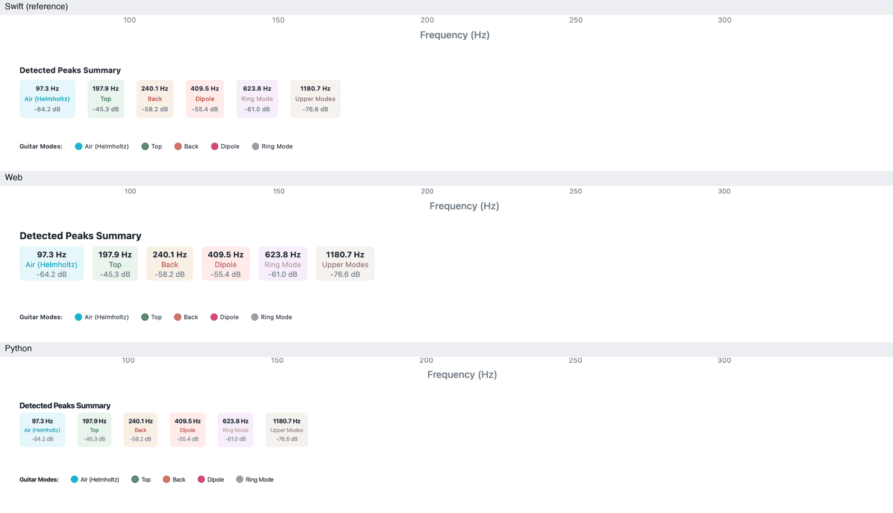
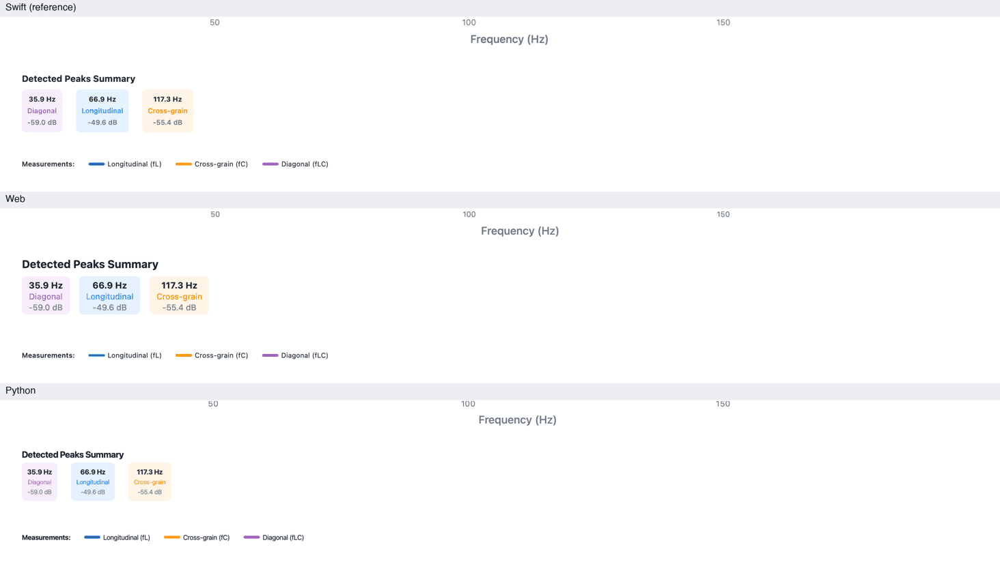
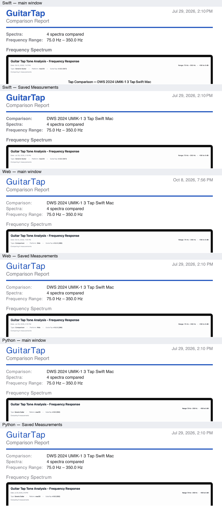
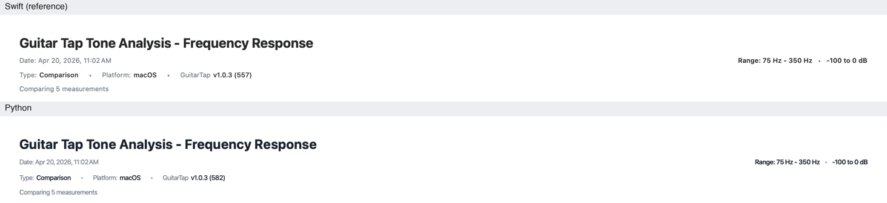
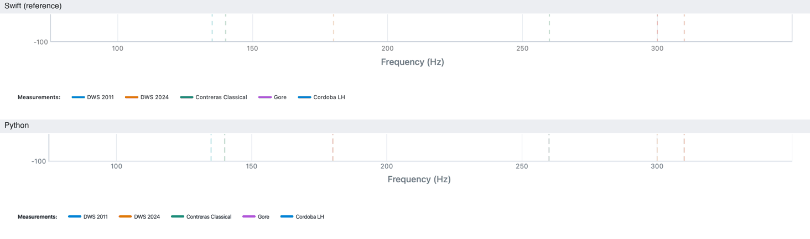

# Export checker findings 2–5

Theme #2, step 7 (THEME-SPEC §9b). The export checker compared the web's and Python's PNG and PDF exports with
Swift's: five cases (guitar, multi-tap, plate, brace and a saved comparison), each exported from the main window
and from Saved Measurements. Finding 1 (frequency labels) is in §9b. This document holds the evidence, cause and
recommendation for findings 2–5.

**Decided (owner, 2026-10-08): all the recommendations below are agreed. Implemented 2026-10-08 (Swift `a11d791`, Python `01201e0`, web `67f99f7`)** —
every edition's exports now pass the checker against Swift's, all 20; see THEME-SPEC §9b for what changed where.

All four findings are about the exported files themselves, so the evidence is the exports. The live graph doesn't
show the summary, the PDF pages or the file names.

| Finding | What differs | Decision |
|---|---|---|
| 1 · Frequency labels | End label half past the plot's edge on Swift; "Hz" on the live chart only | Same labels live and exported, no unit, no label past the edge (done) |
| 2 · Peaks summary | Web draws the summary larger, Python smaller; both place it from fixed numbers | Web and Python take Swift's sizes and spacing, and build the summary from content as Swift does |
| 3 · Multi-tap PDF, page 2 | Swift's main-window page lacks the "Comparison:" line; dates and Type differ between editions and paths | Fix Swift's main-window page; one rule for dates; the web follows Swift's Type (typography: see the correction below) |
| 4 · Python header and axis title | Python's axis title is 4 pt high; its header rows are spaced and sized differently | Python paints the axis title itself at Swift's place; header rows use Swift's spacing and sizes |
| 5 · Export file names | Which timestamp names a file depends on the edition and the path | One rule: a measurement's own timestamp whenever there is one |

## Finding 2 — the detected-peaks summary under the chart

*Guitar (single tap), exported from Saved Measurements: Swift, web and Python, top to bottom. The main window gives
the same result.*

*Plate: the same summary, with cards labelled by role. Plate and brace images have no material-properties block;
those properties appear only in the PDF.*

**What was measured** — in points from the top of the 1464 × 1188 pt image:

| Part | Swift | Web | Python |
|---|---|---|---|
| "Detected Peaks Summary" heading | 1019–1031 | 1009–1023.5 | 1008.5–1020 |
| Card rows (frequency, mode, dB) | 1050.5 · 1067 · 1084.5 | 1041.5 · 1058 · 1074 | shorter cards, smaller text |
| Legend | 1143.5–1155 | 1143.5–1155 | 1128.5–1140 (15 pt high) |

**Why** — the editions draw the summary with different sizes, and the web and Python place it with fixed numbers
Swift doesn't use:

| Setting | Swift (reference) | Web | Python |
|---|---|---|---|
| Heading | 13 pt bold | **16 bold** | 13 bold |
| Card frequency | 10 bold | **13 bold** | 10 bold |
| Card mode name, dB | 10 | **12** | **9** |
| Card padding | 8 all round | **10 sides, fixed 56 tall** | 8 |
| Card height | from its text, about 63 | **56, fixed** | **about 50 (Qt line heights)** |
| Space between cards | 20 | **14** | 20 |
| Cards shown | up to 8, by frequency | **as many as fit** | up to 8 |
| Summary top | follows from the layout (about 1008) | **fixed at 1001** | **fixed at 1001, no top padding** |
| Legend position | follows from the content above | **fixed: summary top + 119 + 29** | **follows Python's shorter cards** |
| Image height | derived from its content | **added up from constants** | **hard-coded 1188 / 1069** |

The web's legend lands where Swift's does only because its fixed 119 pt was copied from Swift's measured height.
Code: Swift `ExportableSpectrumChart.swift:660–752`; web `spectrumExport.ts:57–217`; Python
`exportable_spectrum_chart.py:1003–1095`, with the total height at `:830`.

**Recommendation (agreed)**
- The web and Python take Swift's values: heading 13 bold; card frequency 10 bold, mode name and dB 10; card padding
  8, 4 between rows, 20 between cards; up to 8 cards by frequency; summary padded 8 above and below.
- Each card's height, the summary's height, the legend's place and the image's height come from the content, as in
  Swift, not from constants copied from Swift's measurements, so a change to one part moves the parts below it in all
  three editions together.
- First confirm the summary's real top in Swift (about 1008 by inference, against the 1001 the others assume) with a
  render. The checker then holds all of it to Swift's positions.

## Finding 3 — page 2 of the multi-tap PDF

*Top of page 2 (the per-tap comparison) for fixture "DWS 2024 UMIK-1 3 Tap Swift Mac": each edition from the main
window, then from Saved Measurements. The web's and Python's text looks regular weight here only because the renderer
used for this picture substituted a font with no bold; see the correction below.*

The checker compares main with main and saved with saved, so this first read as the web and Python adding a line. In
fact the odd one out is Swift's own main window. Looking closely at the pages showed four further differences the
checker can't see (see "The checker itself" below).

| | Swift main | Swift saved | Web main | Web saved | Python main | Python saved |
|---|---|---|---|---|---|---|
| "Comparison: &lt;name&gt;" line | **missing** | yes | yes | yes | yes | yes |
| Report date (top right) | measurement | measurement | **time of export** | measurement | measurement | measurement |
| Date in the chart image | **time of export** | measurement | **time of export** | measurement | **none (row missing)** | measurement |
| Type in the chart image | Generic Guitar | Generic Guitar | **Comparison** | **Comparison** | Generic Guitar | Generic Guitar |

**Why**
- **The missing line.** Swift's main-window page 2 takes its label only from the save form's name
  (`TapToneAnalysisView+Export.swift:405`), which is empty after a load. Swift's own page 1 (`:312`), its
  saved-comparison export (`:213`) and its page-2 chart title (`:439`) all fall back to the loaded measurement's
  name; page-2 notes have the same gap (`:406`). The web and Python fall back on every path.
- **Dates.** The editions don't share a rule for which date a page or image shows when a saved measurement is exported
  from the main window. The web uses the time of export on that path (`App.tsx:724` builds the measurement afresh), and
  Swift does the same in the page-2 image. Python's main-window page-2 image leaves the date row out.
- **Type.** The web labels the per-tap image "Comparison" where Swift shows the guitar type.

**Recommendation (agreed)**
- **Swift:** page 2 falls back to the loaded name and notes, like page 1 — two lines at `+Export.swift:405–406`;
  nothing changes in the web or Python.
- **One rule for dates, everywhere:** a page or image made from a measurement shows the measurement's date. The time
  of export appears only in the "Generated by" footer. This fixes Swift's main page-2 image, the web's main page and
  image, and Python's missing row.
- **Type:** the web's per-tap image shows the guitar type, as Swift does.

**Correction (2026-10-08) — the typography difference was not real.** The "regular weight, grey labels" seen in the
web's and Python's pages came from the tool that rendered the comparison pictures: Swift embeds its fonts, while the
web (jsPDF) and Python (reportlab) use the standard PDF Helvetica unembedded, and that renderer substituted a face
with no bold. Read from the PDF files themselves, all three set the same elements in Helvetica-Bold, and the field
labels in the same grey (#787880). What does differ, from a full element-by-element comparison:
- Headings, big card values and property values with no colour set in Swift came out pure black (#000000); the web
  and Python draw them in the palette's near-black (#1C1C1E). Decided (owner, 2026-10-08): the near-black — Swift's
  report views now set it as their default text colour.
- Python draws a plate's empty role cell ("–") in the text colour where Swift uses secondary grey.
- The web's comparison table doesn't mark an overridden mode (Swift sets it italic with " *").

## Finding 4 — Python's header rows and x-axis title

*Header of the saved comparison image: Swift above, Python below. Python's rows are set smaller and spaced a little
wider.*

*Below the plot: Swift above, Python below. Python's "Frequency (Hz)" sits 4 pt higher.*

- The x-axis title is at 956–970.5 pt in Python, against Swift's 960–974.5: 4 pt high in every image. It was recorded
  at step 30 as "pyqtgraph's own offset", but never accepted.
- The third header row ("Comparing 5 measurements", or the material's line) starts at 120 pt in Python, against
  Swift's 116.5. Python lays its rows out in fixed 24 pt boxes; Swift's rows are 24 then 23 pt apart.
- The header row text is visibly smaller in Python. Both ask for 11, but Python sets it as a pixel size in Qt, and Qt
  measures that differently from SwiftUI's point size.

**Recommendation (agreed)**
- Python paints "Frequency (Hz)" itself at Swift's position, as it already paints the chart title, instead of relying
  on pyqtgraph's axis label (`exportable_spectrum_chart.py:422`).
- Header rows use Swift's spacing, and their text size is matched to Swift's by measurement, not by number
  (`:913–999`).
- The checker then holds Python to Swift within the usual 3 pt.

## Finding 5 — which timestamp names an exported file

Every exported file is named `<name>-<seconds>`, with the shared rules in `export-filename.json`. What differs is the
moment the seconds come from:

| Export | Swift | Web | Python |
|---|---|---|---|
| Main window, PDF of a loaded measurement | measurement's time | **time of export** | **time of export** |
| Main window, PDF of a loaded comparison | **time of export** | **time of export** | **time of export** |
| Main window, PNG of a loaded measurement | **time of export** | **time of export** | **time of export** |
| Saved Measurements, PNG or PDF | measurement's time | measurement's time | measurement's time |

For example, the same guitar exported twice from Swift's main window gives
`dws-2024-umik-1-swift-mac-1784225155.pdf` (the measurement) and `…-1791492771.png` (the export). Swift is
inconsistent with itself here, so there is no single Swift behaviour to copy.

**Recommendation (agreed)** — one rule for every edition and path: **a file exported from a saved or loaded
measurement (or a saved comparison) is named with that measurement's own timestamp.** The time of export applies only
to something never saved, such as a live result or an ad-hoc comparison. The same measurement then gives the same
file name wherever it's exported from, and exporting it again replaces the earlier file rather than adding another.
This adds a "seconds" rule to the shared `export-filename.json` cases, and the checker compares names.

## The checker itself — what it couldn't see

Several page-2 differences in finding 3 got past the checker:
- It writes every date as `<date>`, so the measurement's date and the time of export look the same to it.
- It compares the PDF's text and positions, but not weight or colour, so bold against regular passed.
- It doesn't read text inside images (the date, the Type and the chart title in the embedded chart).

**Recommendation (agreed)**
- **Dates:** the checker knows each fixture's timestamp, so it can require the measurement's own date wherever Swift
  shows it, and allow the time of export only in the footer.
- **Typography:** the PDF reader already sees each character's font and colour, so the checker can compare each
  line's weight and colour with Swift's.
- **Text inside images:** leave it for now. Reading it needs text recognition, a large new dependency, and positions
  and sizes catch most of what goes wrong there.
